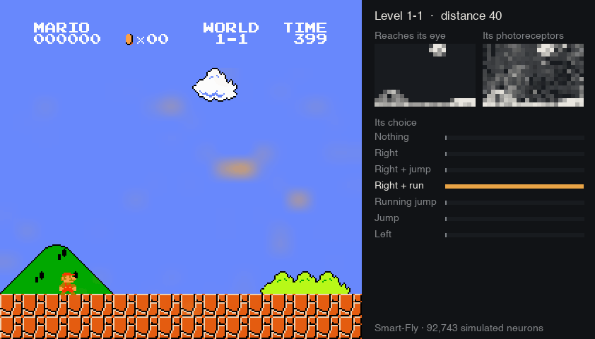
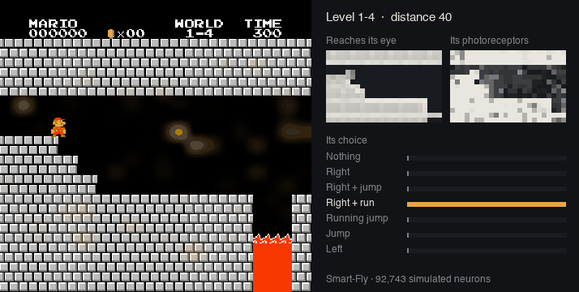
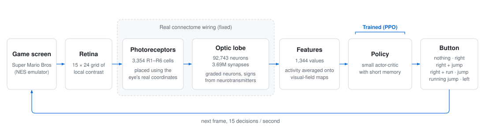

# Smart-Fly

**A fruit fly's visual system, simulated neuron by neuron from the real connectome, learning to play Super Mario Bros.**

[](https://github.com/Puneeth-RV/Smart-Fly/actions/workflows/ci.yml)

[](LICENSE)

**[Watch it play](https://puneeth-rv.github.io/Smart-Fly/)**: recorded runs of every
level it has mastered, with what reaches its eye, its neurons and the buttons it
weighed, and the same fly blind or with its pixels scrambled.

<p align="center">
  
</p>

The eye and optic lobe of a male fruit fly (92,743 neurons and 3.69 million
synapses, from the MaleCNS v1.0 connectome) are simulated from their real wiring
and shown the game screen. A small network, trained by reinforcement learning,
turns what those neurons do into button presses. The fly has mastered Worlds 1-1,
1-2 and 1-4, using only its top choice, from varied starts, and is working on 1-3.

## Does it really see?

Ten attempts per condition, top choice only, each attempt starting after a random
delay. Each column is the fly saved when the campaign passed that level:
`models/fly-1-2.pt` for 1-1 and 1-2, `models/fly-campaign.pt` for 1-4.

| | World 1-1 | World 1-2 | World 1-4 |
|---|---|---|---|
| **Normal eyes** | **10 / 10 finished** · avg distance 3,161 | **6 / 10 finished** · avg 2,539 | **5 / 10 finished** · avg 2,244 |
| Blind (screen blanked) | 0 / 10 · 313 | 0 / 10 · 688 | 0 / 10 · 232 |
| Scrambled (same pixels, random positions) | 0 / 10 · 705 | 0 / 10 · 258 | 0 / 10 · 428 |
| Random buttons | 0 / 10 · 710 | 0 / 10 · 646 | 0 / 10 · 353 |

Blind, it walks into the first Goomba. Scrambled, so that it gets the same
brightness and the same amount of change but no layout, it does no better than
random buttons. Its skill depends on *where* things are on the screen.

Ten attempts is a small sample. On 1-2 the fly passed its campaign test 9 of 10;
over 30 fresh attempts it finished 21 (70%). Of the 9 failures, 3 still ran over
the ceiling into the Warp Zone and 6 died earlier in the level. On 1-4 it passed
its campaign test 8 of 10; over 30 fresh attempts it finished 16 (53%), and all
14 failures ended at Bowser on the final bridge.

It also forgets. The fly that mastered 1-4 still finishes 1-1 10 of 10, but 1-2
0 of 10: most attempts now end around distance 945. While it trained on 1-3 and
1-4, each earlier level got 13-20% of its practice. Measured with
`python -m smartfly.evaluate`; raw results are in [`results/`](results/).

## Progress

The campaign tests a level every 1.5M frames of training and moves on at 8 of
10. So far (133M frames in all, on one MacBook Air):

| Level | Status | Training on it |
|---|---|---|
| 1-1 | passed 10/10 | 1.5M frames, after 10M on 1-1 alone |
| 1-2 | passed 9/10 | 50.9M, unstuck by making the Warp Zone a dead end |
| 1-3 | in progress, 0/10 | 42.1M; one jump stops it, see below |
| 1-4 | passed 8/10 | 28.6M, mostly learning to get past Bowser |

<p align="center">
  
</p>

Next: 1-3 with practice starts, then World 2, and keeping earlier levels while
learning new ones.

## How it works

<p align="center">
  
</p>

1. **Retina.** Each frame becomes a 15 × 24 grid of local contrast, which marks
   edges such as pipes, gaps and enemies.
2. **Eye.** Each photoreceptor is placed on the screen where the optic-lobe
   columns it connects to look, using the connectome's ommatidial coordinates.
3. **Brain.** The photoreceptors and optic lobe run as graded (non-spiking)
   neurons on the published wiring, with signs from each neuron's transmitter.
   This part is fixed: nothing in the connectome is trained.
4. **Policy.** Optic-lobe activity, averaged onto maps of the visual field, is
   read by a small actor-critic network with a few decisions of memory. This is
   the only part that learns, by PPO, rewarded for moving right and penalised for
   dying.
5. **Campaign.** The fly works through the game level by level: train, test 10
   attempts from random starts, and move on at 8 of 10. A level it fails is set
   aside and revisited with practice starts, which begin some attempts part-way
   along the furthest route so far.

Details in [docs/how-it-works.md](docs/how-it-works.md).

## What is real and what is learned

- **Real:** the wiring. Which of the 92,743 neurons connect to which, how many
  synapses, and whether each excites or inhibits, all from the connectome. So is
  where each part of the eye looks.
- **Chosen:** how neurons behave (graded units with one time constant) and two
  constants (inhibition 4x, coupling 0.5). The connectome records connections,
  not their strengths.
- **Learned:** the policy network that turns optic-lobe activity into buttons.
  It is a standard network; the fly brain does not learn here.
- **Not claimed:** that this is how a fly would play Mario, or that it plays
  levels it has not trained on.

## Quick start

Python 3.12. The repository includes the fly's visual system (12.8 MB)
and three trained flies, so nothing else needs downloading.

```bash
git clone https://github.com/Puneeth-RV/Smart-Fly.git && cd Smart-Fly
python -m venv .venv && source .venv/bin/activate
pip install -e .
python -m smartfly.compat          # NumPy 2 fixes for the NES emulator (once)
```

Watch the trained fly's results, with its eyes intact, blanked and scrambled:

```bash
python -m smartfly.evaluate models/fly-campaign.pt --level 1-1 --attempts 10
```

Open the live site: the fly playing, what it sees, its neurons, the buttons it
weighs, its rewards, and finished levels on request. The
[published version](https://puneeth-rv.github.io/Smart-Fly/) plays recordings instead
(`python -m smartfly.web.record`, then `scripts/publish_site.sh`).

```bash
python -m smartfly.web.server --checkpoint models/fly-campaign.pt   # http://localhost:8090
```

Train it yourself (about 4 hours for 1-1 on a laptop), or run the whole campaign:

```bash
python -m smartfly.train --levels 1-1 --frames 10e6 --out runs/1-1
scripts/start.sh                    # campaign + live site, in the background
```

<details>
<summary>Rebuilding the visual system from the raw connectome</summary>

```bash
pip install -e ".[connectome]"
python -m smartfly.connectome.download   # 1.15 GB of the 23 GB release
python -m smartfly.connectome.build      # whole-brain matrix, ~2 minutes
python -m smartfly.connectome.visual     # data/visual_system.npz
```
</details>

## Repository

```
smartfly/
  game.py          NES emulator wrapper and the frame-to-retina reduction
  eye.py           where each photoreceptor looks on the screen
  brain.py         graded neurons on the connectome's wiring
  fly.py           eye + brain + the 1,344 features the policy reads
  policy.py        the network, its memory, and Player for running a trained fly
  train.py         PPO training
  campaign.py      all 32 levels, unattended
  evaluate.py      normal / blind / scrambled / random test
  probe.py         what each layer of the visual system encodes
  connectome/      download, build, and extract the visual system
  web/             the live site's server, and the recorder for the published one
site/              the page
scripts/           start the campaign, run it on Azure, publish the site, make the GIFs
models/            trained flies
results/           the measurements quoted here
docs/              how it works, and the journey
archive/           earlier experiments
```

## What was learned along the way

The working fly came after several approaches that failed, each measured and
explained in [docs/journey.md](docs/journey.md):

- **The whole brain could not learn.** Spiking all 166,197 neurons and letting
  the fly's own learning circuit adjust itself scored no better than random. The
  visual signal fell by about a quarter at every synapse and was gone before it
  reached any learning circuit.
- **The eye was 40% blind.** The connectome's eye coordinates sit on a hexagonal
  lattice; treating its axes as x and y left most of the screen ahead of Mario
  unseen.
- **Spiking neurons destroyed the picture; graded ones kept it.** A real fly's
  early visual system mostly does not spike. Switching raised how well what the
  policy reads reveals a wall ahead from 63% to 76% (50% is chance), and reading
  the photoreceptors' own map took it to 85%.
- **"20 out of 20" was one memorised path.** From varied starts it was 4 of 10;
  training with varied starts took it to 10 of 10.
- **The reward chose the Warp Zone.** On 1-2 the fly stalled for 40M frames. Its
  failures ended in the Warp Zone, reached over the ceiling: more distance than
  the real exit, but no way out without a Down button. Making that route a dead
  end took it from 0/10 to 9/10 in 7.5M frames.
- **One jump stopped 1-3.** Every test ended at the same treetop. A search over
  button sequences showed the jump works only after a brief slow-down before
  take-off, found by about 2% of random sequences; the fly had learned to run
  flat out everywhere. Practice starts along the furthest route got it over
  the jump for the first time after 16M more frames.
- **The simulated optic lobe is chaotic.** A one-in-ten-million nudge changes the
  fly's choices within a second of play, so exact runs differ between computers;
  results are rates over many varied attempts.

## Limitations

- It has mastered three of World 1's four levels and is working on 1-3. One
  pass through all 32 levels is roughly two weeks of computing, and some (the
  maze castles and underwater levels) may not pass.
- Learning a new level costs some of the old ones, as 1-2 shows above.
- The policy learns each level; it does not play unseen ones.
- Deep in the optic lobe the picture blurs. The wiring is known but synaptic
  strengths are not, and connectome-constrained models of fly vision
  (Lappalainen et al., *Nature*, 2024) fit those by training, which this does not.

## Credits

- **Connectome:** MaleCNS v1.0, released by Google Research and HHMI Janelia under
  CC-BY 4.0. See [male-cns.janelia.org](https://male-cns.janelia.org/). This
  repository includes a derived subset (`data/visual_system.npz`).
- **Emulator:** [gym-super-mario-bros](https://github.com/Kautenja/gym-super-mario-bros)
  and [nes-py](https://github.com/Kautenja/nes-py).
- **Related work:** Lappalainen, J. K. et al. *Connectome-constrained networks
  predict neural activity across the fly visual system.* Nature (2024).

Code under the [MIT License](LICENSE).
